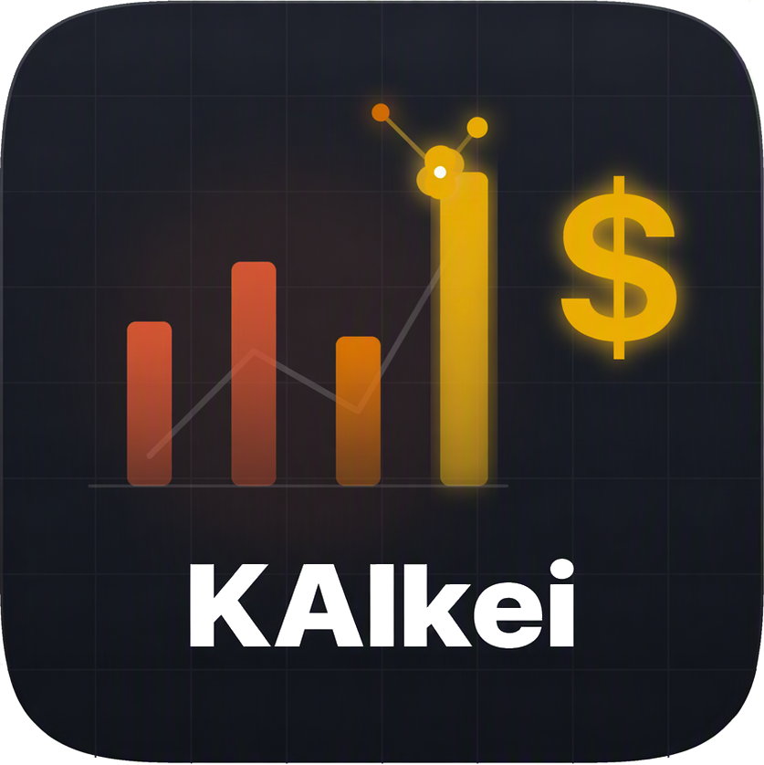
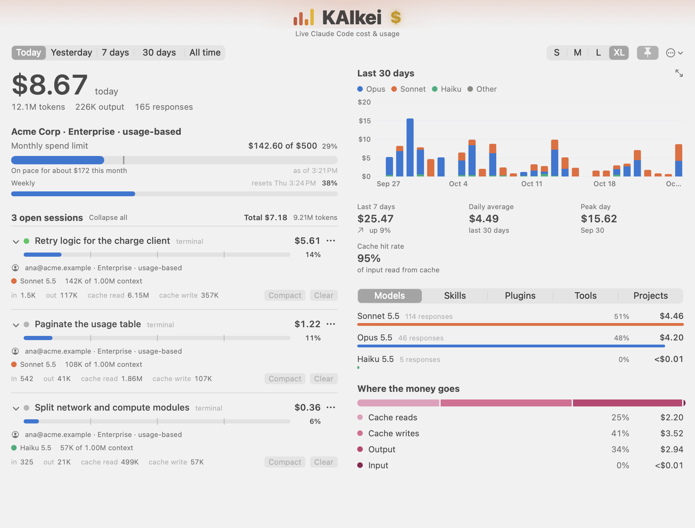
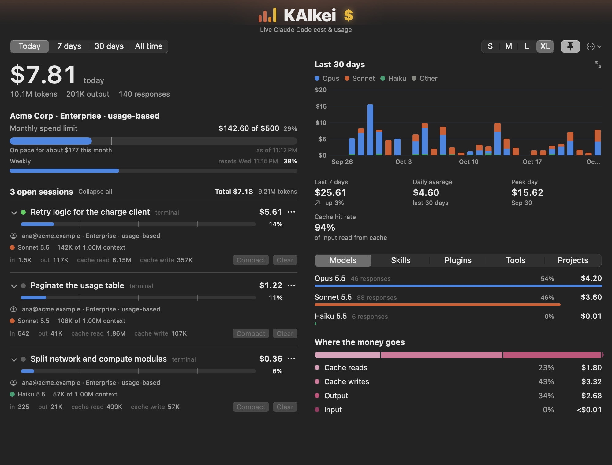
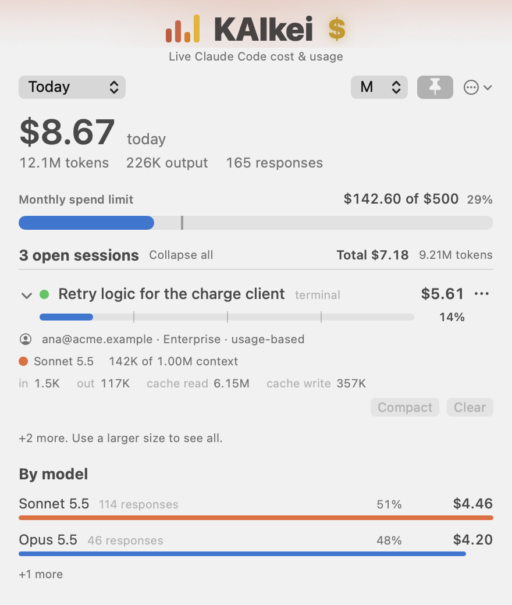
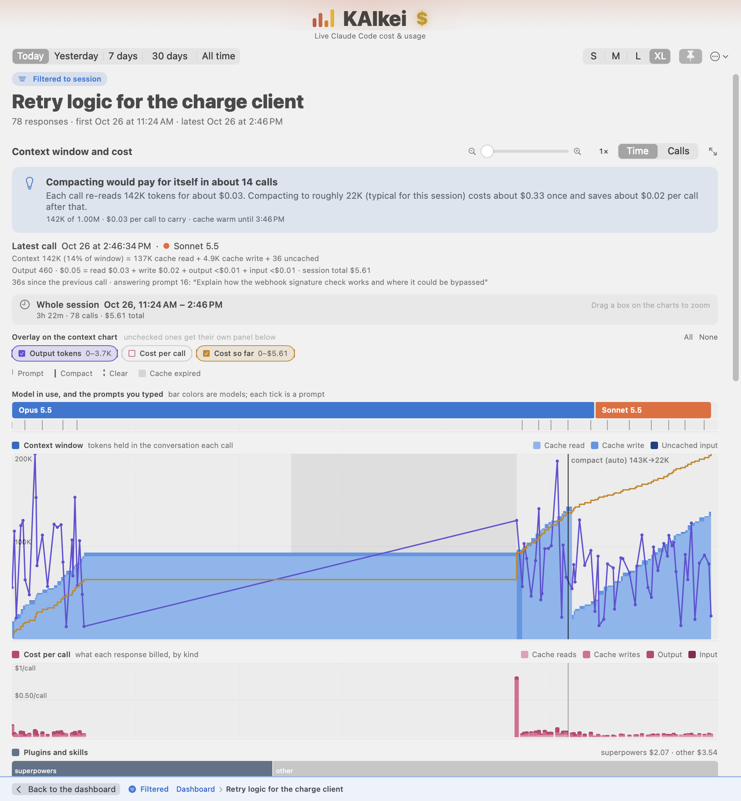
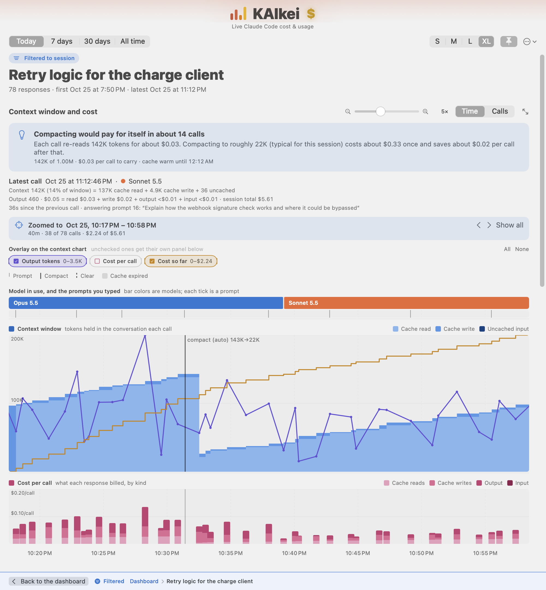
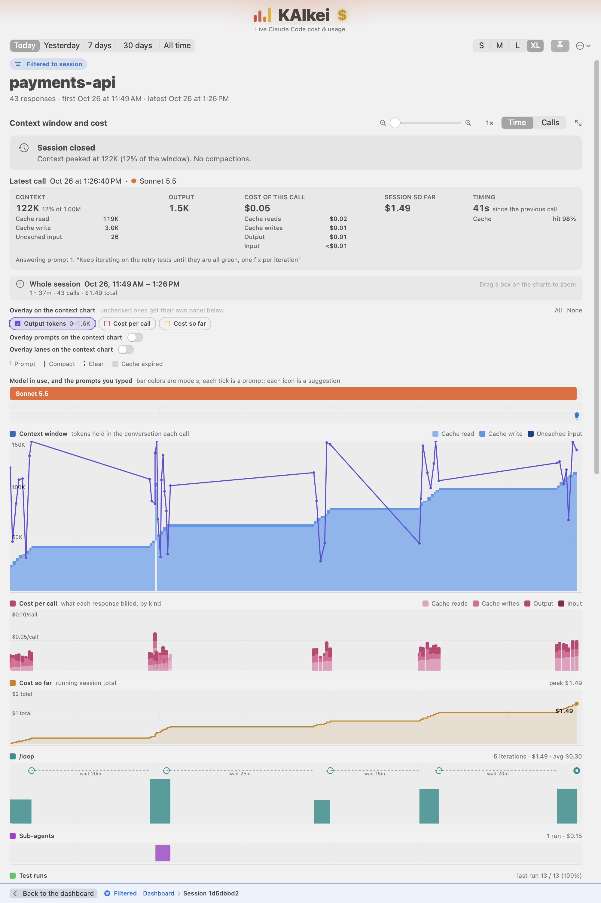
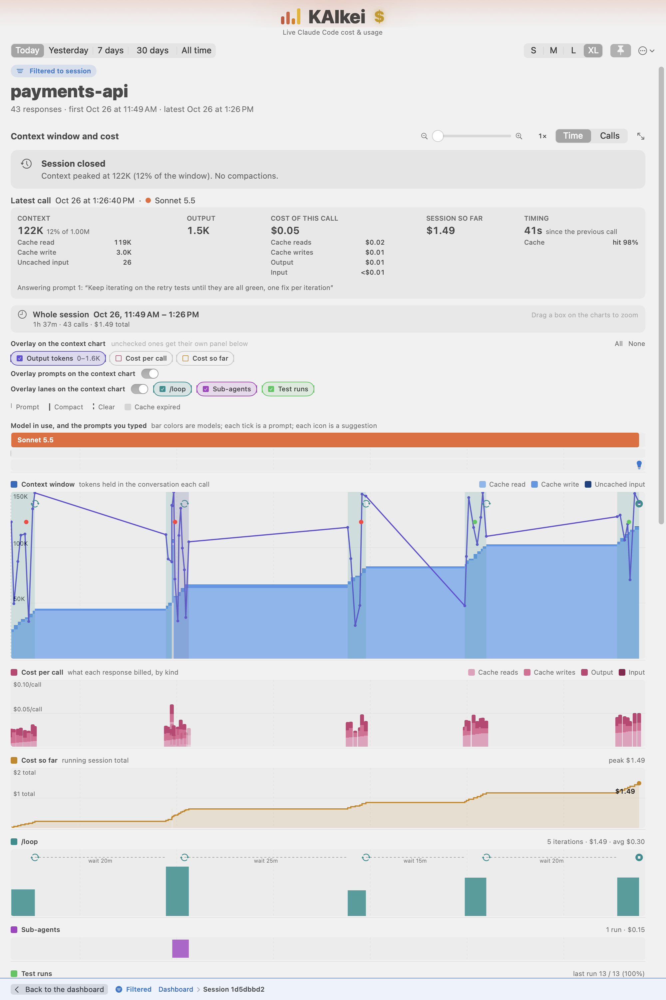
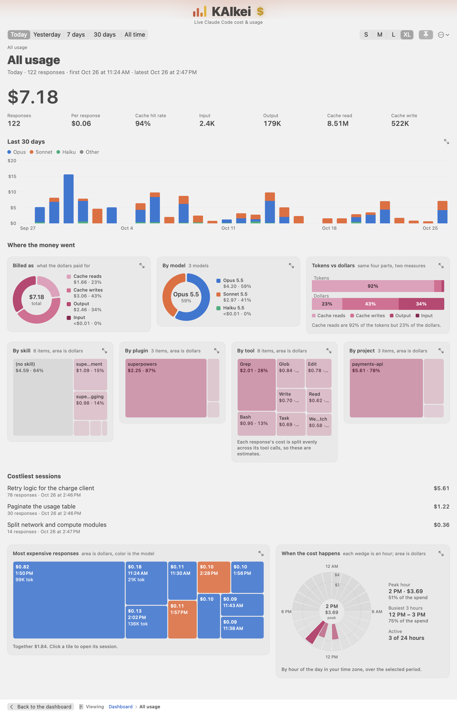

<p align="center"></p>

<h1 align="center">KAIkei</h1>

> ### 会計 · かいけい · *kaikei*
>
> **noun (Japanese)**
>
> 1. **Accounting; bookkeeping; finance.** The practice of recording, totalling and reporting money. The word is built
>    from 会 (*kai*, "to gather, to meet") and 計 (*kei*, "to measure, to count"): literally, *gathering the count*.
> 2. **The bill; the check.** What you ask for at the end of a meal: *"o-kaikei onegaishimasu"*, "the check, please."
>
> KAIkei is the second meaning for your Claude Code sessions: it tells you what the meal cost, and which dishes were
> expensive. (The **AI** is in the middle of the name on purpose.)

<p align="center"><b>Stop guessing what Claude Code costs.</b><br>
A native macOS window and menu-bar app that shows live spend, context gauges and your monthly limit for every open
Claude Code session, then shows exactly where every dollar went. Its session timeline tells you when to
<code>/compact</code> or <code>/clear</code> to save money. <b>Private by design: everything is read locally and nothing leaves your machine.</b></p>

<p align="center"></p>

<p align="center"><sub>Screenshots use invented data (see <a href="#screenshots-and-demo-data">below</a>), not a real account.</sub></p>

## Install

Requires macOS 14 or later and the Swift command line tools (no Xcode needed).

```
git clone https://github.com/dberanjr/KAIkei.git
cd KAIkei
make install   # builds KAIkei.app and copies it to ~/Applications
```

Or grab `KAIkei-0.2.1-macOS-arm64.zip` from the [latest release](https://github.com/dberanjr/KAIkei/releases/latest). The
build is ad-hoc signed, not notarized, so on first launch right-click the app and choose **Open** (or run
`xattr -dr com.apple.quarantine KAIkei.app`).

## What it does

A native macOS window and menu-bar item that shows what your Claude Code sessions are using right now:
one row per open terminal (the status-line numbers, plus the account and license it runs under), a total,
your monthly spend limit, breakdowns by model, skill, plugin, tool and project, and a 30-day trend with
week-over-week change, daily average, peak day and cache hit rate.

<table>
<tr>
<td width="62%"></td>
<td width="38%"></td>
</tr>
<tr>
<td align="center"><sub>XL, dark mode</sub></td>
<td align="center"><sub>M: the essentials in a small window (S, M, L, XL and Full, top right)</sub></td>
</tr>
</table>

**Click almost anything to drill in**: a terminal, a breakdown row, a bar in the chart, the headline total.
The detail page shows that one thing's trend, the other breakdowns cut by it, its costliest sessions and
responses, and when in the day the cost happens. Rows inside a detail page open the next level. Back, or Esc, returns.

A session's detail page opens with a **context window and cost timeline** for deciding when to compact or clear:

- the context window over time, stacked into cache read, cache write and uncached input, with auto and manual
  compactions as vertical lines (labelled with tokens before and after) and the window size as a dashed line;
- a model ribbon showing which model was answering when, a tick for every prompt you typed, and shaded stretches
  where the prompt cache had expired while the session sat idle;
- aligned panels for output tokens (thinking shown separately), the cost of each call split by what it was billed as, and a
  cumulative cost line ending in the running total. Every panel has a header saying what it measures, and each chart type
  has its own color family (blue context, violet output, magenta cost per call, gold cost so far) so it stays
  recognisable when overlaid;
- **overlay checkboxes** above the charts: tick Output tokens, Cost per call or Cost so far to draw it on the context
  chart, scaled from 0 to its own peak in view (shape only, since two real scales on one axis would mislead). Unticked
  ones keep their own panel underneath. Hover cards always show the true values;
- **zoom**: a slider beside the Time / Calls switch, or drag a box across any chart. Every panel zooms to the chosen
  stretch, rescales to what is in view, and a banner above the charts states the window ("Zoomed to Oct 22, 12:37:23 PM
  – 12:38:46 PM · 4 of 16 calls · $0.16 of $0.66"). Arrows move the view, Show all (or a double-click) zooms out. The
  cost-so-far panel restarts at $0 at the left edge of a zoomed view;
- hover any panel for the call under the pointer: the readout line updates at once, and resting on a slice for 0.8 s opens a
  card with everything about it (the prompt it answered, context breakdown, tokens, cost parts, spend so far, cache state,
  idle gap, tools, and any prompt or compaction in that slice);
- quick cards (about 0.12 s) on the event bars: a prompt tick (what it cost to answer), a compaction or clear line (tokens
  freed, how long it took, what the next call cost) and a stretch of the model ribbon (calls, cost, context peak);
- a **details tile** above the charts for the latest call (or the one under the pointer): the context split into cache read,
  cache write and uncached input, the output, the cost split by what it was billed as, the session total so far, how long
  since the previous call and whether the cache hit;
- a **suggestions bar** under the prompt ticks: an icon (lightbulb, warning, snowflake) wherever KAIkei's compact advisor
  would have suggested compacting, or noted that the cache had expired. They are replayed from the transcript at today's list
  prices, so you can go back and see when a suggestion would have appeared; hover one for what it said;
- a green **turn-end** circle on the prompt bar for every answered prompt, joined to its prompt tick by a thin line; hover it for
  "Turn N complete": duration, tool count, tokens read (↓) and written (↑), responses and cost;
- a Time / Calls switch (Time shows idle gaps; Calls spaces every response evenly for long sessions);
- for an open session, a cost-based nudge: what carrying the context costs per call, what compacting would cost and
  save, whether the cache is warm, and the extra a cold cache would add to the next prompt.

### Claude Code feature lanes

When a session used `/loop`, sub-agents, test runners or plugins, its timeline grows a lane for each, on the same time axis
as the charts above (a session that used none of them shows nothing extra):

- **`/loop`**: one vertical band per iteration, its height the iteration's cost (sub-agent spend included). An icon marks each
  moment Claude decided to loop again or stopped, a dashed line shows the wait before the next wake-up, and a warning icon
  marks a wake-up nobody scheduled (the harness's fallback timer). The header gives iterations, total cost and the average.
- **Sub-agents**: one bar per run from its first to its last response, stacked when runs overlap, labelled with what the
  parent asked for.
- **Test runs**: a bar per run split into passed and failed, from the summary the runner printed (`swift test`, XCTest,
  pytest, vitest, jest). The header shows the last run ("13 / 13 (100%)"). If the output of the last run cannot be read, it
  says so and never shows green; a session that ends red says "ended red".
- **Plugins and skills**: one bar of cost by plugin, with the smaller ones folded into "other".

The **Overlay lanes on the context chart** switch (off by default, remembered) draws the loop bands and decision icons,
sub-agent runs (as a faint full-height wash) and test-run dots on the context chart as well, with a checkbox per lane. Two more checkboxes, **Prompts** and **Suggestions**, draw a faint dashed line at every prompt you typed and the suggestion icons (with a guide line) on the chart. Hovering a test dot, a loop decision icon or a suggestion icon opens its card. Hover any element for its card:
an iteration's cost, calls, tokens and how late it woke; a decision's delay and reason; a run's duration and cost; a test run's pass ratio.

A `/goal` lane is not built yet: Claude Code does not document how a goal's outcome is written to the transcript, and no
`/goal` run was available to read. It will follow once a real one has been captured.

Settings (the ellipsis button) holds a **hover speed** slider from Instant to 1 s, which also scales the quick cards on
event bars, plus the all-desktops and cache-pricing options.

The **drill-down breakdown** is a dense panel instead of lists: donuts for what the dollars were billed as and for models,
a pair of bars comparing each kind's share of tokens with its share of dollars (cache reads are most of the tokens and a
fraction of the bill), and treemaps sized by dollars for skills, plugins, tools and projects. Model colors identify
models; the magenta family always means dollars.

The foot of a drill-down page has the **most expensive responses** as a treemap (area is dollars, color is the model, click a
tile to open its session) and **when the cost happens** as a 24-wedge dial: midnight at the top, hours clockwise, each
wedge's area (not its length) proportional to that hour's spend, with hover for any hour and a caption giving the peak
hour and the busiest three hours.

Zooming a timeline: drag a box on any chart (a box is drawn as you drag, naming the stretch you will zoom to), use the
slider, or scroll sideways with a trackpad (or hold Shift with a mouse wheel) to move a zoomed view. Charts have their own
pointer surface because the window can be dragged by its background, which swallowed the drag.

**Maximize any chart**: every chart (the session timeline, the 30-day trend, each donut and treemap, the responses
treemap and the 24-hour dial) has a corner button that opens it in its own window as big as the screen, with type and
panels scaled up. The window stays live, follows the selected period, and shares zoom and overlay choices with the copy on
the page. Esc or Close shuts it. It floats above other windows only while the main window is pinned.

**Filtering and Back**: opening any item narrows the view to it. While a detail page is open, a bar pinned to the foot of the
window (outside the scrolling page, so there is never a scroll back to the top) says "Filtered" with the trail
(Dashboard › Model › Session), a Back button naming where it goes, clickable earlier levels, and Clear all when more than
one filter is stacked. The page header carries a matching "Filtered to ..." marker. Esc also goes back.

A fresh install overlays output tokens and the running cost on the context chart (cost per call keeps its own panel);
changing it is remembered.

**Open sessions** start collapsed to one line; open one with its chevron (or Expand all) to see its model, context, token counts, when it started and how long since its last turn. They can be archived (the row's ... menu or
right-click). Archiving only hides a row from the list: the session keeps running, its spend still counts in the period
totals, and a footer shows how many are archived and what they cost, with Show / Restore. Both are remembered per
session id.

Small windows (S, M) show the essentials; L adds the output and cost panels; XL adds event labels and taller charts; Full is the XL layout stretched over the screen's usable area.
The advice is an estimate from list prices: compacting is assumed to leave about 20K tokens until the session has
compacted on its own (then its median is used), and the cache lifetime is an hour if the session ever wrote a 1-hour
entry, otherwise five minutes. Prompt text is kept in memory only, for a 100-character hover preview.

### Screenshots

<p align="center"></p>
<p align="center"><sub>A session's context window and cost timeline. Here an Opus session compacts itself (143K to 22K) and carries on with Sonnet.</sub></p>

<p align="center"></p>
<p align="center"><sub>Zoomed to the 40 minutes around the compaction: every panel rescales to what is in view.</sub></p>

<p align="center"></p>
<p align="center"><sub>A self-paced <code>/loop</code> over five iterations: the loop lane (cost per iteration, waits, decision icons), the sub-agent it launched, and a test run per iteration going from red to green.</sub></p>

<p align="center"></p>
<p align="center"><sub>The same session with the lane overlay on: loop iterations as vertical bands with decision icons along the top, the sub-agent as a purple wash, test runs as red and green dots, and a suggestion icon on the bar above the chart.</sub></p>

<p align="center"></p>
<p align="center"><sub>The drill-down breakdown for all usage: where the dollars went, by billing kind, model, skill, plugin, tool and project, and when in the day.</sub></p>

## Commands

```
make test      # 325 tests for parsing, pricing, aggregation, accounts, trends, drill-down, timelines, terminal control
make run       # build "KAIkei.app" and open it
make install   # copy it to ~/Applications
make icon      # rebuild Resources/AppIcon.icns from Resources/AppIcon-source.png (only after replacing the artwork)
```

Sizes S / M / L / XL / Full (top right), a pin to keep it above other windows (or let it behave like a normal one),
and a menu to show it on every desktop. Settings are remembered. `--dump` prints what the collector sees;
`--snapshot L out.png [dark] [sessions=6] [drill=model:claude-sonnet-5-5] [height=1800]` renders a size to a PNG
without a visible window (`sessions=N` pads the open-session list to test busy days; `drill=` opens a detail page, e.g.
`total`, `session:live`, `day:3`, `skill:NAME`). `lanes=on` and `lanesoverlay=loop,agents,tests|all` draw the loop,
sub-agent and test-run lanes' markers on the context chart as well as in their own lanes.

Each size shows the richest layout that fits its window and drops lower-priority pieces (extra sessions first, then
breakdown rows, the trend strip, the cost split) instead of scrolling. Detail pages do scroll.

## Where the numbers come from

Everything is read locally. No login token or keychain item is read.

| Data | Source |
|---|---|
| Open sessions | `~/.claude/sessions/<pid>.json`, kept only if the process is alive |
| Tokens, models, skills, plugins, tools, thinking tokens, effort | `~/.claude/projects/**/*.jsonl` transcripts (assistant rows) |
| Prompts, `/clear` and other slash commands, compactions (trigger, tokens before and after) | the same transcripts (user rows and `compact_boundary` rows) |
| Loop wake-ups, decisions and stops | `scheduled_task_fire` rows, and `ScheduleWakeup` calls and results, in the same transcripts |
| Sub-agent runs | `Agent` calls and their launch results, plus the sub-agents' own rows (`agentId`) |
| Test runs | the output of Bash commands that start with a known test runner; only a summary the runner printed is read |
| Account, license, monthly spend limit and rate-limit windows | identity fields and the `cachedUsageUtilization` entry of `~/.claude.json` (the same figures as the Desktop app's Settings > Usage, as Claude Code caches them) |
| Exact context %, window size, effort, +/- lines, duration | statusLine JSON in `/tmp/claude-console/sessions/` (only if the Claude Console plugin's handler is installed; optional) |

## Read these before trusting a number

- **Cost is computed** from token counts at published list prices (`Sources/UsageCore/Pricing.swift`). Cache writes
  use 2x for 1-hour entries; the menu offers a flat 1.25x basis.
- **It will not match the status line's cost.** On the sessions checked, Claude Code's `total_cost_usd` was 10-25% lower
  than the token-based figure, and neither cache-write basis explains it. The status line's number is shown next to
  ours, labelled, and never substituted. The cause is unresolved.
- **Tool and skill costs are attributions.** A response that made N tool calls charges 1/N of its cost to each.
- Transcripts repeat a response once per content block; the collector counts each `message.id` once.
- The statusline bridge and Desktop "Usage" section limits (plan usage / rate limits) are **not** shown: that data
  needs your login token, which this app does not touch.

## Compact and Clear buttons

They type `/compact` or `/clear` plus Enter into the terminal tab running that session, using AppleScript keyed
by tty. macOS asks once for permission (Privacy & Security > Automation).

- Verified against a scratch Terminal.app tab: the tab receives the text and a carriage return.
- Not verified: iTerm2 (script written, not exercised) and against a live Claude Code prompt.
- Disabled for Desktop-app sessions, other terminals (Ghostty, VS Code, Warp), and while Claude is busy.
- Clear asks for confirmation.

## Build notes

- Command Line Tools only: no Xcode, so no WidgetKit extension and no `@State` (its macro plugin ships with Xcode).
  Transient UI state lives in `UsageStore`.
- The sources live in OneDrive, which stamps files with attributes that break `codesign`. The Makefile builds in
  `~/Library/Caches/ClaudeUsageWidget`.

## Accounts and plan limits

- The account on each row is whoever Claude Code is signed in as in `~/.claude.json`. Every session reads that one file,
  so all rows show the same account. A session started with a different `CLAUDE_CONFIG_DIR` would be attributed
  to the default account, and Desktop-hosted sessions are assumed to share it too.
- The spend limit is a cache that Claude Code refreshes while it runs, so it can trail Settings > Usage; the band says
  when it was fetched. "On pace" divides spend so far by the elapsed share of the calendar month and assumes the limit
  resets on the 1st. Rate-limit windows (5-hour, weekly) appear only for plans that have them.
- Your computed costs only cover this machine. The plan figure covers the whole account, so the two need not match.

## Screenshots and demo data

The pictures above are rendered from an invented account (`ana@acme.example`, four made-up projects, 30 days of
generated transcripts), never from real sessions. `KAIKEI_HOME=<dir>` points the app at another directory in place of
your home folder, which is how:

```
make build
scripts/screenshots.sh   # regenerates docs/screenshots/*.png
```

builds a synthetic `~/.claude` and `~/.claude.json` (`scripts/make_demo_home.py`) and renders every screenshot from it.
(KAIkei only counts a session as open while its process exists, so the script starts three throwaway `sleep`s to stand in.)

## License

Apache 2.0, see [LICENSE](LICENSE).
